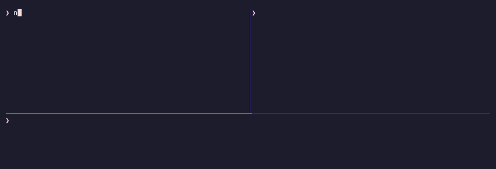

<h1 align="center">nlock</h1>

<p align="center">
  <b>Make commands take turns.</b><br>
  Named locks for your shell: jobs from any terminal, script, cron job or
  coding agent wait in line instead of colliding.
</p>

<p align="center">
  <a href="https://github.com/erietz/nlock/releases/latest"></a>
  <a href="./LICENSE"></a>
  
</p>

<p align="center">
  
</p>

## Quick start

```sh
brew install erietz/tap/nlock && brew services start nlock
nlock run gpu -- python train.py   # run this in two terminals: the second waits its turn
```

Not on macOS? See [Installation](#installation) for Debian, Ubuntu, Arch and
source builds.

## Why not `flock`?

`flock` is a solid way to guard a file. `nlock` adds a small daemon that tracks
every lock, so it can serve waiters in order and show who holds what.

|                                                   | `flock`                | `nlock`                                 |
|---------------------------------------------------|------------------------|-----------------------------------------|
| Lock names                                        | a file path you manage | any string: `gpu`, `"$PWD"`, `/dev/ttyACM0` |
| Waiters run in arrival order                      | no guarantee           | yes, first come first served            |
| See who holds a lock and who is waiting           | no                     | `nlock list`, plus a message when you wait |
| Let *n* commands run at once                      | no                     | `--slots n`                             |
| Readers share, writers aren't starved             | readers can starve writers | `--shared`, writers keep their place |
| Collapse a burst of triggers into one run         | no                     | `--coalesce`, `--replace`               |

Full documentation is in [the man page](./docs/nlock.1.md) (`man nlock`).

## Examples

Every `nlock run` that uses the same lock name waits its turn and runs in
arrival order. The lock is released when the command exits, including when it
crashes or is killed. Locks are per user and cover everything you run: other
terminals, tmux panes, cron jobs, editors and agents.

**Take turns on a shared resource.** Start this from as many terminals as you
like and the jobs queue up instead of competing for the GPU:

```bash
nlock run gpu -- python train.py --config large.yaml
```

**Skip a cron run if the previous one is still going:**

```cron
# Linux: cron does not set XDG_RUNTIME_DIR, so point nlock at the daemon's socket
NLOCK_SOCKET=/run/user/1000/nlock.sock
*/15 * * * * nlock run -n backup -- restic backup ~/Documents
```

**See which locks are held, by which process, and who is waiting:**

```bash
watch -n 1 nlock list
```

<details>
<summary>Scripts, waiting and exit status</summary>

**Chain on the result.** `nlock run` exits with the command's exit status, so
it works with `&&`, `||` and `set -e` like the command alone would:

```bash
nlock run build -- make -j8 && ./bin/app
nlock run deploy -- ./deploy.sh || notify-send "deploy failed"
```

**Choose how long to wait:**

```bash
nlock run -n deploy -- ./deploy.sh       # exit 75 right away if a deploy is running
nlock run -t 300 deploy -- ./deploy.sh   # exit 75 after 5 minutes without the lock
```

**Hold a lock by hand.** Open a shell under the lock, and anything else that
takes `deploy` waits until you exit:

```bash
nlock run deploy -- "$SHELL"
```

**Fan out the work and serialize the writes.** Eight downloads run at once,
and each response is appended whole, never interleaved with another:

```bash
seq 100 | xargs -P 8 -I{} sh -c \
  'curl -s https://jsonplaceholder.typicode.com/posts/{} | nlock run results -- tee -a results.jsonl > /dev/null'
```

</details>

<details>
<summary>Naming locks after what they protect</summary>

A lock name can be any string, so naming a lock after the thing it protects
keeps unrelated jobs from blocking each other:

```bash
# Builds in the same checkout take turns; separate worktrees build in parallel
nlock run "$PWD" -- make -j8

# Two uploads to the same board can't collide on the serial port
nlock run /dev/ttyACM0 -- arduino-cli upload -p /dev/ttyACM0 --fqbn arduino:avr:uno Blink

# Backups to the same disk run one after another instead of competing for it
nlock run /Volumes/Backup -- rsync -a ~/Pictures/ /Volumes/Backup/Pictures/

# A migration and a bulk import never write to the database at the same time
nlock run ~/app/dev.db -- ./migrate.sh
nlock run ~/app/dev.db -- ./import.sh data.csv
```

</details>

<details>
<summary>Coding agents and git worktrees</summary>

**Let parallel coding agents share one test database.** Put the command in
`AGENTS.md` or `CLAUDE.md`, and agents in separate worktrees queue for the
database instead of breaking each other's test runs:

```bash
nlock run test-db -- npm test
```

**Block a push when the tests fail.** Worktrees share one hooks directory, so
pushes from parallel worktrees take turns running the suite. Save this as
`.git/hooks/pre-push` and make it executable:

```sh
#!/bin/sh
exec nlock run test-db -- npm test
```

</details>

<details>
<summary>Collapsing bursts of triggers: <code>--coalesce</code> and <code>--replace</code></summary>

**Rebuild on save without a backlog.** A file watcher can fire a dozen times
during one build. `--coalesce` keeps at most one build waiting, and every extra
trigger exits 0. That waiting build hasn't started yet, so it will pick up those
changes too:

```bash
fswatch -o src/ | while read -r _; do
  nlock run --coalesce build -- make -j8 &
done
```

The `&` matters. Without it the loop waits for each build to finish, so requests
never overlap and nothing gets coalesced. On Linux, use
`inotifywait -mrq -e close_write src/` in place of `fswatch -o src/`.

**Keep generated files fresh from git hooks.** Commits, checkouts and merges
each fire a hook, often in quick succession. Save this as `post-commit`,
`post-checkout` and `post-merge` in `.git/hooks/`:

```sh
#!/bin/sh
nlock run --coalesce "tags:$PWD" -- ctags -R . >/dev/null 2>&1 &
```

The `&` lets git carry on right away, and `$PWD` in the name gives each
repository its own job.

**Deploy only the newest push.** Push A, B and C while A is deploying, and the
next deploy is C. B was replaced while it waited. Plain `nlock` would deploy B
and then C; `flock -n` would skip both and leave A live. Save as
`hooks/post-receive` on the server:

```sh
#!/bin/sh
while read -r old new ref; do
  if [ "$ref" = refs/heads/main ]; then
    nlock run --replace deploy -- /srv/app/deploy.sh "$new" >>/var/log/deploy.log 2>&1 &
  fi
done
```

**Which one?** Both flags treat every request for the same lock name as the
same job:

| Each run…                                  | Use          |
|--------------------------------------------|--------------|
| does the same thing (`make`, `ctags -R .`) | `--coalesce` |
| carries newer input (a commit, a value)    | `--replace`  |

Either way, an exit status of 0 means a run is scheduled, not that it
succeeded. So don't chain them with `&&`.

</details>

<details>
<summary>Sharing a lock: <code>--slots</code> and <code>--shared</code></summary>

**Cap how many run at once.** `--slots 2` lets two commands hold the lock
together; a third waits for one of them to finish. Useful for GPUs, parallel
builds or rate-limited downloads, from any number of terminals or scripts:

```bash
nlock run --slots 2 gpu -- python train.py --config large.yaml
```

Every request for a lock in use must ask for the same number of slots. One that
doesn't exits 64 without running.

**Let readers share, and writers go alone.** `-s` (`--shared`) holders run
together; a plain (exclusive) request waits until they have all finished, and
then runs alone. Unlike `flock -s`, a waiting writer is never starved: readers
that arrive after it queue behind it.

```bash
nlock run -s app-db -- ./backup.sh     # these two run at the same time
nlock run -s app-db -- ./report.sh
nlock run app-db -- ./migrate.sh       # waits for both, then runs alone
```

</details>

<details>
<summary>Inspecting locks</summary>

`nlock list` shows each holder, how long it has held the lock, and how many
requests are waiting:

```text
NAME      PID  ELAPSED  WAITERS  MODE       SLOTS  CMD
app-db   4410    01:20        1  shared         -  ./backup.sh
app-db   4415    00:45        1  shared         -  ./report.sh
gpu      4121    12:41        2  exclusive    2/2  python train.py --config large.yaml
gpu      4188    03:02        2  exclusive    2/2  python train.py --config small.yaml
```

**Find locks held for more than an hour:**

```bash
nlock list --json | jq -r --argjson now "$(date +%s)" \
  'select($now - .acquired_at > 3600) | "\(.name): pid \(.pid), \(.command)"'
```

</details>

## Installation

### Homebrew

```sh
# install the tap and the formula
brew tap erietz/tap
brew install nlock

# start the daemon automatically on login
brew services start nlock
```

### Debian / Ubuntu

Download the `.deb` package for your architecture from the
[latest release](https://github.com/erietz/nlock/releases/latest) and install
it with `apt`:

```sh
# x86_64 (amd64)
sudo apt install ./nlock_<version>_amd64.deb

# aarch64 (arm64)
sudo apt install ./nlock_<version>_arm64.deb
```

After installation, enable and start the daemon as your user:

```sh
systemctl --user daemon-reload
systemctl --user enable --now nlockd
```

### Arch Linux

Download the `.pkg.tar.zst` package for your architecture from the
[latest release](https://github.com/erietz/nlock/releases/latest) and install
it with `pacman`:

```sh
# x86_64
sudo pacman -U nlock-<version>-1-x86_64.pkg.tar.zst

# aarch64
sudo pacman -U nlock-<version>-1-aarch64.pkg.tar.zst
```

After installation, enable and start the daemon as your user:

```sh
systemctl --user daemon-reload
systemctl --user enable --now nlockd
```

### From source (user installation)

To install from source:

1. Clone the repository:
    ```bash
    git clone https://github.com/erietz/nlock.git
    cd nlock

    # Trust the mise.toml file
    mise trust
    # Install the dependencies
    mise install
    # Build and install to ~/.local as the predefined prefix
    mise run install
    ```
2. Start the nlockd service:
    1. Linux:
        ```bash
        mise run daemon-systemd-user-start
        ```
    2. macOS:
        ```bash
        mise run daemon-launchd-user-start
        ```

If you do not have `mise` installed, view the commands in `./mise.toml` and run
them manually.

See `man nlock` for every option.
